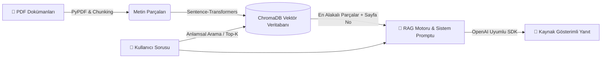

# 📚 DocuMind AI — Dokümanlarla Konuşan RAG Asistanı

Bu proje, Microsoft'un **[Generative AI for Beginners](https://github.com/microsoft/generative-ai-for-beginners)** müfredatındaki temel üretken yapay zeka ve **RAG (Retrieval-Augmented Generation)** prensiplerini gerçek dünya senaryosunda uygulamak amacıyla geliştirilmiştir.

Kullanıcıların yüklediği PDF dokümanlarını örtüşmeli metin parçalarına (overlapping chunks) ayırır, çok dilli vektör temsillerine (embeddings) dönüştürerek **ChromaDB** üzerinde saklar ve sorulan sorulara **yalnızca doküman içeriğinden sayfa numarası referansı vererek** yanıt üretir.

---

## 🖥️ Uygulama Arayüzü


---

## 🎯 Kapsanan Microsoft Kurs Modülleri

| Kurs Modülü | Konu | Projedeki Uygulaması (`src/`) |
| :--- | :--- | :--- |
| **Ders 04 & 05** | Prompt Engineering Fundamentals | Sistem istemi (System Prompt) tasarımı ve rol tanımlama (`rag_engine.py`) |
| **Ders 06 & 07** | Text Generation & Chat Apps | OpenAI SDK istemci mimarisi ve Streamlit oturum hafızası (`app.py`) |
| **Ders 08** | Building Search Apps (RAG) | PDF ayrıştırma, kelime korumalı Chunking, Embeddings ve Semantic Search (`document_processor.py`, `vector_store.py`) |
| **Ders 13** | Securing & Grounding AI | Halüsinasyon önleme (Grounding), kaynak/sayfa doğrulama ve `.env` güvenliği |

---

## 🏗️ Sistem Mimarisi



---

## 📂 Proje Klasör Yapısı

```text
documind-rag/
├── app.py                      # Streamlit tabanlı interaktif web arayüzü
├── src/
│   ├── document_processor.py   # PDF okuma ve kelime korumalı metin parçalama (Chunking)
│   ├── vector_store.py         # Çok dilli Embedding üretimi ve ChromaDB vektör arama
│   └── rag_engine.py           # Bağlam zenginleştirme (Augmentation) ve LLM yanıt üretimi
├── test_connection.py          # API bağlantı doğrulama betiği
├── requirements.txt            # Gerekli Python kütüphaneleri
├── .env.example                # Ortam değişkenleri şablonu
└── .gitignore                  # Git tarafından yoksayılacak gizli dosyalar
```

---

## 🚀 Hızlı Kurulum (Kendi Bilgisayarınızda Çalıştırın)

Projeyi kendi bilgisayarınıza kurmak ve çalıştırmak için aşağıdaki komutları sırasıyla terminalinize yapıştırın:

### 1. Projeyi İndirin ve Sanal Ortamı Kurun
```bash
git clone https://github.com/eren074/documind-rag.git
cd documind-rag
python3 -m venv venv
source venv/bin/activate  # Windows için: venv\Scripts\activate
```

### 2. Gerekli Kütüphaneleri Yükleyin
```bash
pip install -r requirements.txt
```

### 3. API Anahtarınızı Tanımlayın (.env)
Örnek şablonu kopyalayarak kendi `.env` dosyanızı oluşturun:
```bash
cp .env.example .env
```
Ardından `.env` dosyasını açıp [Google AI Studio](https://aistudio.google.com/apikey) üzerinden ücretsiz aldığınız API anahtarınızı `LLM_API_KEY=` kısmına yapıştırın.

### 4. Uygulamayı Başlatın
```bash
streamlit run app.py
```
Tarayıcınızda otomatik açılan `http://localhost:8501` adresinden PDF yükleyip soru sormaya başlayabilirsiniz!

---

## 🛡️ Halüsinasyon Önleme (Grounding) ve Modül Testleri
Sistem, yüklenen dokümanlarda yer almayan bir soru sorulduğunda kendi genel kültürünü kullanmayı reddeder. Tüm alt modüller bağımsız olarak terminalden test edilebilir:
```bash
python3 test_connection.py
python3 src/document_processor.py
python3 src/vector_store.py
python3 -m src.rag_engine
```
