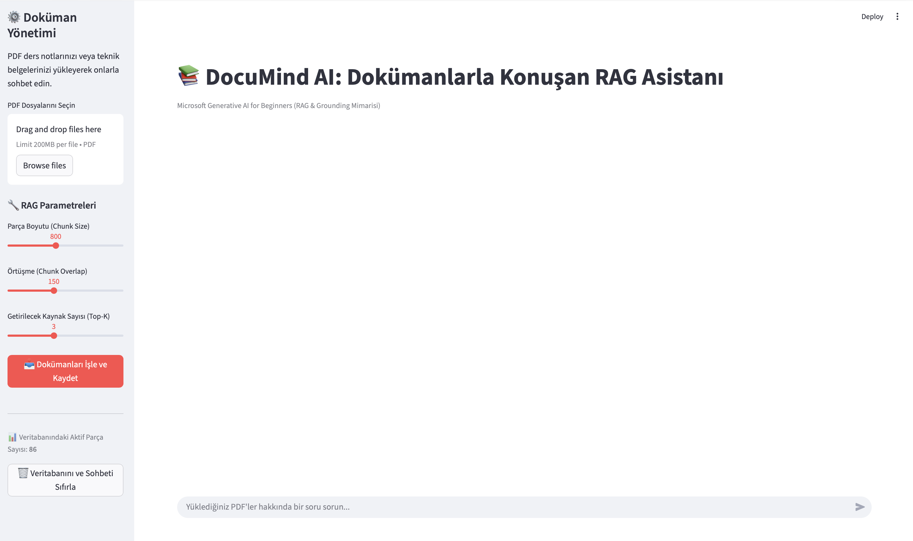
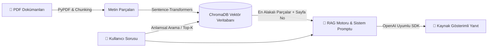

# 📚 DocuMind AI — Dokümanlarla Konuşan RAG Asistanı

Bu proje, Microsoft'un **[Generative AI for Beginners](https://github.com/microsoft/generative-ai-for-beginners)** müfredatındaki temel üretken yapay zeka ve **RAG (Retrieval-Augmented Generation)** prensiplerini gerçek dünya senaryosunda uygulamak amacıyla geliştirilmiştir.

Kullanıcıların yüklediği PDF dokümanlarını örtüşmeli metin parçalarına (overlapping chunks) ayırır, çok dilli vektör temsillerine (embeddings) dönüştürerek **ChromaDB** üzerinde saklar ve sorulan sorulara **yalnızca doküman içeriğinden sayfa numarası referansı vererek** yanıt üretir.

---

## 🖥️ Uygulama Arayüzü

---

## 🎯 Kapsanan Microsoft Kurs Modülleri

| Kurs Modülü | Konu | Projedeki Uygulaması (`src/`) |
| :--- | :--- | :--- |
| **Ders 04 & 05** | Prompt Engineering Fundamentals | Sistem istemi (System Prompt) tasarımı ve rol tanımlama (`rag_engine.py`) |
| **Ders 06 & 07** | Text Generation & Chat Apps | OpenAI SDK istemci mimarisi ve Streamlit oturum hafızası (`app.py`) |
| **Ders 08** | Building Search Apps (RAG) | PDF ayrıştırma, kelime korumalı Chunking, Embeddings ve Semantic Search (`document_processor.py`, `vector_store.py`) |
| **Ders 13** | Securing & Grounding AI | Halüsinasyon önleme (Grounding), kaynak/sayfa doğrulama ve `.env` güvenliği |

---

## 🏗️ Sistem Mimarisi

